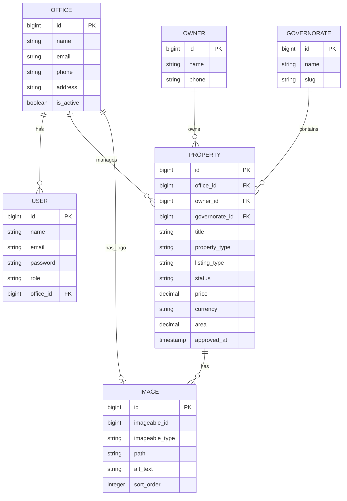
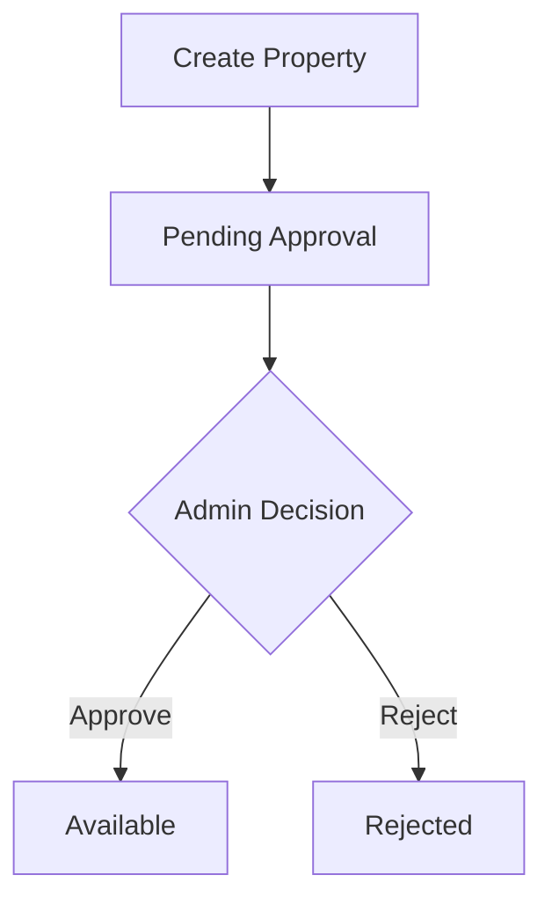

# Darna API

A RESTful API for managing real estate listings, offices, property owners, and governorates. Darna provides role-based access control, property approval workflows, image management, filtering, and caching.

## Table of Contents

- [Overview](#overview)
- [Technology Stack](#technology-stack)
- [Getting Started](#getting-started)
- [Project Architecture](#project-architecture)
- [Database Design](#database-design)
- [Entity Relationships](#entity-relationships)
- [User Roles and Permissions](#user-roles-and-permissions)
- [Property Lifecycle](#property-lifecycle)
- [Authentication](#authentication)
- [API Reference](#api-reference)
- [Filtering Properties](#filtering-properties)
- [Request and Response Examples](#request-and-response-examples)
- [Validation and Error Handling](#validation-and-error-handling)
- [Caching Strategy](#caching-strategy)
- [Image Management](#image-management)
- [Design Decisions](#design-decisions)
- [API Versioning](#api-versioning)

---

## Overview

Darna is a Laravel-based real estate API designed to manage property listings through a centralized system.

The application supports three user roles:

- **Admin:** Manages the platform, offices, and property approval.
- **Office:** Manages properties belonging to its own office.
- **User:** Browses publicly available and approved properties.

The API also supports property images, property owners, governorates, listing filters, featured properties, and governorate statistics.

The application is API-only and returns JSON responses.

## Technology Stack

| Technology | Purpose |
|---|---|
| PHP 8.2+ | Backend programming language |
| Laravel 12 | Backend framework |
| Laravel Sanctum 4 | API authentication |
| SQLite | Database |
| Eloquent ORM | Database interaction and relationships |
| Laravel Cache | Caching |
| Laravel Form Requests | Input validation and authorization |
| Laravel API Resources | Consistent JSON responses |
| Laravel Policies | Resource-level authorization |
| Composer | PHP dependency management |

## Getting Started

### Requirements

Make sure the following tools are installed:

- PHP 8.2 or later
- Composer
- SQLite support enabled in PHP
- Git

### 1. Clone the Repository

```bash
git clone https://github.com/ayadd22/-Darna-.git
cd -Darna-
```

### 2. Install Dependencies

```bash
composer install
```

### 3. Configure Environment

Create the environment file:

```bash
cp .env.example .env
```

On Windows PowerShell, use:

```powershell
Copy-Item .env.example .env
```

Generate the application key:

```bash
php artisan key:generate
```

### 4. Configure the Database

Darna uses SQLite.

Ensure that the following file exists:

```text
database/database.sqlite
```

If it does not exist, create it:

```powershell
New-Item database/database.sqlite -ItemType File
```

Configure the database connection in `.env`:

```env
DB_CONNECTION=sqlite
```

### 5. Run Migrations

```bash
php artisan migrate
```

### 6. Create the Storage Symbolic Link

```bash
php artisan storage:link
```

This allows files stored on Laravel's public disk to be accessed through the public storage directory.

### 7. Start the Development Server

```bash
php artisan serve
```

The API will be available at:

```text
http://127.0.0.1:8000/api/v1
```

---

## Project Architecture

Darna follows a layered architecture that separates HTTP handling, business logic, database interaction, and authorization.

### Main Application Structure

```text
app/
├── Cache/
│   └── PropertyCacheKeys.php
│
├── Contracts/
│   ├── PropertyServiceInterface.php
│   └── PropertyImageServiceInterface.php
│
├── Enums/
│   ├── UserRoleEnum.php
│   ├── PropertyStatusEnum.php
│   ├── PropertyTypeEnum.php
│   ├── ListingTypeEnum.php
│   └── CurrencyEnum.php
│
├── Http/
│   ├── Controllers/
│   ├── Middleware/
│   ├── Requests/
│   └── Resources/
│
├── Models/
├── Policies/
├── Providers/
└── Services/
```

### Controllers

Controllers handle incoming HTTP requests and coordinate the required application operations.

For example, `PropertyController` receives property-related requests and delegates business operations to the appropriate services.

Controllers are kept separate from the main business logic to avoid mixing HTTP handling with application rules.

### Services

Services contain the application's business logic.

**PropertyService**

Responsible for:

- Creating and updating properties.
- Retrieving and filtering properties.
- Applying visibility rules.
- Approving and rejecting listings.
- Deleting properties.
- Retrieving featured properties.
- Calculating governorate statistics.
- Managing related cache invalidation.

**PropertyImageService**

Responsible for:

- Storing property images.
- Generating unique image filenames.
- Deleting individual images.
- Deleting all images associated with a property.

### Contracts and Dependency Injection

The application defines service interfaces:

- `PropertyServiceInterface`
- `PropertyImageServiceInterface`

The interfaces describe the operations that the services must provide.

`AppServiceProvider` binds each interface to its concrete implementation.

For example:

```php
$this->app->bind(
    PropertyServiceInterface::class,
    PropertyService::class
);
```

Controllers depend on interfaces rather than concrete service classes.

This follows the Dependency Inversion Principle and allows Laravel's service container to resolve the appropriate implementation.

### Form Requests

Form Requests handle:

- Input validation.
- Request-level authorization.
- Custom validation messages.
- Validation rules for property creation, updates, filtering, and image uploads.

This keeps validation logic outside controllers.

### API Resources

API Resources control how models are transformed into JSON responses.

Darna uses:

- `PropertyResource`
- `ImageResource`

This provides a consistent response structure and avoids returning raw Eloquent models directly.

### Policies

`PropertyPolicy` handles property-level authorization.

It checks whether a user can view, create, update, delete, or approve a property.

### Middleware

The application uses two middleware components:

- `EnsureUserHasRole`: Restricts routes based on user roles.
- `OptionalSanctumAuth`: Resolves an optional authenticated user on public property listing routes.

The `role` middleware alias is registered in `bootstrap/app.php`.

---

## Database Design

Darna uses relational database tables and Eloquent ORM relationships.

### Main Entities

| Entity | Description |
|---|---|
| User | Represents an account that can authenticate and access the system. |
| Office | Represents a real estate office. |
| Owner | Represents the real-world owner of a property. |
| Governorate | Represents the geographic governorate associated with a property. |
| Property | Represents a real estate listing. |
| Image | Stores image metadata for properties and offices. |

### Supporting Tables

Laravel also uses supporting tables for framework functionality:

- `personal_access_tokens`: Stores Sanctum personal access tokens.
- `cache`: Stores cached data when the database cache driver is used.
- `jobs`: Supports queued jobs.
- `sessions`: Stores sessions.
- `password_reset_tokens`: Supports password reset functionality.

### Entity Relationship Diagram



### Entity Relationships

#### User and Office

- An Office can have many Users.
- A User belongs to one Office.
- `users.office_id` is nullable.

An Admin or regular User does not necessarily belong to an office.

#### Office and Property

- An Office can manage many Properties.
- Each Property belongs to one Office.

This relationship is also used to restrict office users to their own listings.

#### Owner and Property

- An Owner can have many Properties.
- Each Property belongs to one Owner.

The `Owner` entity is intentionally separate from `User`.

An Owner represents the real-world property owner, while a User represents an account that can authenticate and interact with the application. A property owner does not need a system login account.

#### Governorate and Property

- A Governorate can contain many Properties.
- Each Property belongs to one Governorate.

This relationship supports geographic filtering and governorate statistics.

#### Property and Image

A Property can have multiple Images.

Images are stored through a polymorphic relationship using:

```text
imageable_id
imageable_type
```

#### Office and Image

An Office can have one logo through a `MorphOne` relationship.

The same `images` table is used for both property images and office logos.

The application uses a single-image relationship for the office logo, but the database does not enforce uniqueness for office logo records.

---

## User Roles and Permissions

Darna defines three user roles using `UserRoleEnum`.

| Role | Value | Description |
|---|---|---|
| Admin | `admin` | Platform administrator |
| Office | `office` | Real estate office account |
| User | `user` | Regular platform user |

### Admin

An Admin can:

- View all properties.
- Create properties.
- Update and delete properties.
- Approve and reject pending properties.
- Access all owners.
- Access property management endpoints.

### Office

An Office user can:

- View properties belonging to its office.
- Create properties under its own office.
- Update and delete properties belonging to its office.
- Manage images for its own properties.
- Access owners associated with its office's properties.

Office users cannot approve or reject properties.

The `office_id` is assigned from the authenticated user when an Office creates a property. The Office cannot choose another office through the property creation request.

### User

A regular User can:

- Browse available and approved properties.
- View property details that are publicly visible.
- Browse featured properties.
- View governorates and active offices.

Regular Users cannot access property management operations.

### Authorization Layers

Darna uses two authorization layers:

1. **Role Middleware:** Checks whether the authenticated user's role is allowed to access a route.
2. **Property Policy:** Checks whether the user has permission to perform an operation on a specific property.

For example, an Office user may access the property update route, but the policy still checks whether the property belongs to that user's office.

---

## Property Lifecycle

Properties follow an approval workflow.



### Property Statuses

| Status | Value | Description |
|---|---|---|
| Pending Approval | `pending_approval` | Waiting for Admin review |
| Available | `available` | Approved and available for public viewing |
| Reserved | `reserved` | Reserved property |
| Sold | `sold` | Sold property |
| Rejected | `rejected` | Rejected by Admin |

New properties are automatically created with:

```text
pending_approval
```

When an Admin approves a property:

- Its status changes to `available`.
- `approved_at` is set to the current timestamp.

When an Admin rejects a property:

- Its status changes to `rejected`.
- `approved_at` remains null.

Only properties in the `pending_approval` state can be approved or rejected.

---

## Authentication

Darna uses Laravel Sanctum Personal Access Tokens.

Authentication is performed using the login endpoint.

### Login

```http
POST /api/v1/login
Content-Type: application/json
Accept: application/json
```

Request:

```json
{
    "email": "user@example.com",
    "password": "password"
}
```

Successful response:

```json
{
    "message": "تم تسجيل الدخول بنجاح.",
    "token": "YOUR_ACCESS_TOKEN",
    "user": {
        "id": 1,
        "name": "Example User",
        "email": "user@example.com",
        "role": "admin",
        "office_id": null
    }
}
```

The returned token is used to authenticate protected requests.

### Bearer Token

Include the token in the request header:

```http
Authorization: Bearer YOUR_ACCESS_TOKEN
Accept: application/json
```

### Logout

```http
POST /api/v1/logout
```

Requires authentication.

The endpoint deletes the current access token.

It does not delete all tokens belonging to the user.

---

## API Reference

**Base URL**

```text
http://127.0.0.1:8000/api/v1
```

### Authentication Endpoints

| Method | Endpoint | Access | Description |
|---|---|---|---|
| POST | `/login` | Public | Authenticate a user |
| POST | `/logout` | Authenticated | Revoke the current token |

### Property Endpoints

| Method | Endpoint | Access | Description |
|---|---|---|---|
| GET | `/properties` | Public / Optional Authentication | List and filter properties |
| GET | `/properties/{property}` | Public / Optional Authentication | View property details |
| GET | `/properties/featured` | Public | Retrieve featured properties |
| GET | `/properties/stats/by-governorate` | Public | Retrieve governorate statistics |
| POST | `/properties` | Admin, Office | Create a property |
| PUT | `/properties/{property}` | Admin, Office | Update a property |
| DELETE | `/properties/{property}` | Admin, Office | Delete a property |
| PATCH | `/properties/{property}/approve` | Admin | Approve a property |
| PATCH | `/properties/{property}/reject` | Admin | Reject a property |

### Property Image Endpoints

| Method | Endpoint | Access | Description |
|---|---|---|---|
| POST | `/properties/{property}/images` | Admin, Office | Upload a property image |
| DELETE | `/properties/{property}/images/{image}` | Admin, Office | Delete a property image |

### Base Data Endpoints

| Method | Endpoint | Access | Description |
|---|---|---|---|
| GET | `/governorates` | Public | Retrieve governorates |
| GET | `/offices` | Public | Retrieve active offices |
| GET | `/owners` | Admin, Office | Retrieve owners |

The `/owners` endpoint returns all owners to Admin users. Office users only receive owners associated with properties belonging to their office.

---

## Filtering Properties

The property listing endpoint supports the following query parameters.

```http
GET /api/v1/properties
```

| Parameter | Type | Description |
|---|---|---|
| `governorate_id` | Integer | Filter by governorate |
| `listing_type` | Enum | Filter by sale or rent |
| `property_type` | Enum | Filter by property type |
| `min_price` | Numeric | Minimum property price |
| `max_price` | Numeric | Maximum property price |
| `min_area` | Numeric | Minimum property area |
| `max_area` | Numeric | Maximum property area |

### Property Types

- `apartment`
- `shop`
- `land`

### Listing Types

- `sale`
- `rent`

### Currency Values

- `SYP`
- `USD`
- `EUR`

### Example

```http
GET /api/v1/properties?governorate_id=1&listing_type=sale&property_type=apartment&min_price=50000&max_price=150000&min_area=80&max_area=200
```

The API validates that minimum values do not exceed their corresponding maximum values.

### Pagination

The property listing endpoint uses Laravel pagination with 15 records per page.

Example:

```http
GET /api/v1/properties?page=2
```

---

## Request and Response Examples

### Create Property

```http
POST /api/v1/properties
Authorization: Bearer YOUR_ACCESS_TOKEN
Content-Type: application/json
Accept: application/json
```

Example request for an Admin:

```json
{
    "office_id": 1,
    "owner_id": 2,
    "governorate_id": 1,
    "title": "Modern Apartment",
    "description": "A spacious apartment in a central location.",
    "property_type": "apartment",
    "listing_type": "sale",
    "price": 120000,
    "currency": "USD",
    "area": 120,
    "address": "Damascus",
    "contact_phone": "0991234567"
}
```

For Office users, `office_id` must not be included. The application assigns it automatically from the authenticated user's account.

Successful creation returns HTTP `201 Created`.

### Update Property

```http
PUT /api/v1/properties/1
Authorization: Bearer YOUR_ACCESS_TOKEN
Content-Type: application/json
Accept: application/json
```

Example:

```json
{
    "title": "Updated Apartment Title",
    "price": 125000,
    "currency": "USD"
}
```

The update request supports partial updates. Only supplied fields are updated.

### Approve Property

```http
PATCH /api/v1/properties/1/approve
Authorization: Bearer ADMIN_ACCESS_TOKEN
Accept: application/json
```

### Reject Property

```http
PATCH /api/v1/properties/1/reject
Authorization: Bearer ADMIN_ACCESS_TOKEN
Accept: application/json
```

### Upload Property Image

```http
POST /api/v1/properties/1/images
Authorization: Bearer YOUR_ACCESS_TOKEN
Content-Type: multipart/form-data
```

Form fields:

| Field | Type | Required |
|---|---|---|
| `image` | File | Yes |
| `alt_text` | String | No |
| `sort_order` | Integer | No |

Supported image formats:

- JPG
- JPEG
- PNG
- WEBP
- GIF

Maximum upload size: 5 MB.

### Property Response

A property is returned through `PropertyResource`.

Example:

```json
{
    "data": {
        "id": 1,
        "title": "Modern Apartment",
        "description": "A spacious apartment.",
        "property_type": "apartment",
        "listing_type": "sale",
        "status": "available",
        "price": "120000.00",
        "currency": "USD",
        "area": "120.00",
        "address": "Damascus",
        "contact_phone": "0991234567",
        "office_id": 1,
        "owner_id": 2,
        "governorate_id": 1,
        "created_at": "2026-10-27T12:00:00.000000Z",
        "updated_at": "2026-10-27T12:00:00.000000Z"
    }
}
```

The example illustrates the resource's fields. Actual relationship data and pagination metadata depend on the endpoint and loaded relationships.

### Image Resource

```json
{
    "data": {
        "id": 1,
        "path": "properties/1/example-image.jpg",
        "alt_text": "Apartment living room",
        "sort_order": 0,
        "created_at": "2026-10-27T12:00:00.000000Z"
    }
}
```

---

## Validation and Error Handling

Darna uses Laravel Form Requests to validate incoming data.

Validation failures generally return HTTP `422 Unprocessable Entity`.

### Common HTTP Status Codes

| Status | Meaning | Example |
|---|---|---|
| 200 | OK | Successful retrieval or update |
| 201 | Created | Property creation |
| 401 | Unauthorized | Missing or invalid authentication |
| 403 | Forbidden | Insufficient permissions |
| 404 | Not Found | Property not found or not visible |
| 422 | Unprocessable Entity | Validation failure or invalid property state |

### Authentication Error

Unauthenticated API requests return JSON:

```json
{
    "message": "غير مصرح. يجب تسجيل الدخول أولاً."
}
```

### Role Authorization Error

When a user does not have an allowed role:

```json
{
    "message": "ليس لديك صلاحية للوصول إلى هذا المورد."
}
```

### Validation Error

Laravel validation responses include a message and field-specific errors.

Example:

```json
{
    "message": "The given data was invalid.",
    "errors": {
        "title": [
            "The title field is required."
        ]
    }
}
```

Actual validation messages may be customized in individual Form Requests, including Arabic messages.

### Business Rule Error

Trying to approve a property that is not pending approval returns HTTP `422`.

The application provides a specific Arabic message explaining why the operation cannot be performed.

---

## Caching Strategy

Darna uses Laravel's Cache Facade with a cache-aside approach.

The application checks the cache first. If the requested data is not cached, it retrieves the data from the database and stores it for future requests.

### Cache Configuration

The default cache store is configured through:

```php
'default' => env('CACHE_STORE', 'database'),
```

The application uses the configured Laravel cache driver. The default configuration is database-backed caching.

### Cached Data

| Cached Data | Cache Key | TTL |
|---|---|---|
| Property details | `properties:detail:{id}` | 30 minutes |
| Featured properties | `properties:featured` | 15 minutes |
| Governorate statistics | `properties:stats:by-governorate` | 10 minutes |

### Cache Invalidation

Cache entries are invalidated after relevant data changes.

| Operation | Invalidated Cache |
|---|---|
| Create property | Featured properties, governorate statistics |
| Update property | Property details, featured properties, governorate statistics |
| Delete property | Property details, featured properties, governorate statistics |
| Approve property | Property details, featured properties, governorate statistics |
| Reject property | Property details, featured properties, governorate statistics |

The property listing endpoint is not cached because its results depend on user roles, filters, and pagination.

### Why Cache Is Used

Caching helps reduce repeated database queries for frequently accessed data, particularly:

- Featured properties.
- Property details.
- Governorate statistics.

Cache durations are defined centrally in `PropertyCacheKeys`, making them easier to maintain.

---

## Image Management

Darna uses Laravel's public filesystem disk for image storage.

Property images are stored under:

```text
storage/app/public/properties/{property_id}/
```

Each uploaded file receives a UUID-based filename to avoid filename collisions.

The database stores the relative file path in the `images` table.

The `PropertyImageService` handles both file storage and database records.

When an image is deleted, the service removes the stored file if it exists and deletes the corresponding database record.

When a property is deleted, its associated images are also deleted through the image service.

The database uses a polymorphic relationship, allowing the same image table to store property images and office logos.

---

## Design Decisions

### 1. Separate User and Owner Models

A system account and a real-world property owner represent different concepts.

Keeping them separate avoids requiring every property owner to register or authenticate.

### 2. Polymorphic Image Relationship

Instead of creating separate tables for property images and office logos, Darna uses one `images` table.

This reduces duplicated image-management logic and allows different models to use the same image infrastructure.

### 3. Enums for Fixed Values

Enums provide a consistent set of values for:

- User roles.
- Property statuses.
- Property types.
- Listing types.
- Currencies.

They reduce the risk of inconsistent string values throughout the application.

### 4. Service Layer

Business logic is separated from controllers.

This improves organization, makes responsibilities clearer, and helps keep controllers focused on handling HTTP requests.

### 5. Interfaces and Dependency Injection

Controllers and services depend on contracts where appropriate.

Laravel's service container resolves the concrete implementation, reducing direct coupling between application components.

### 6. Policies and Middleware

Middleware handles broad role-based access restrictions, while policies enforce resource-level permissions.

This prevents an Office user from managing properties belonging to another Office.

### 7. Database Constraints and Indexes

Foreign key constraints protect relationships between records.

The property table includes indexes for commonly used filtering and listing fields, including status, price, property type, listing type, and composite filter combinations.

These indexes are intended to support common query patterns.

### 8. Centralized Cache Keys

Cache keys and TTL values are defined in `PropertyCacheKeys` rather than scattered across service methods.

This makes cache management more consistent and maintainable.

---

## API Versioning

Darna organizes API routes by version.

Current route files:

```text
routes/
├── api.php
└── api/
    ├── v1.php
    └── v2.php
```

The main API route file registers both versions:

```php
Route::prefix('v1')->group(base_path('routes/api/v1.php'));

Route::prefix('v2')->group(base_path('routes/api/v2.php'));
```

### Version 1

Version 1 contains the currently implemented API endpoints.

Base URL:

```text
/api/v1
```

### Version 2

Version 2 is currently an empty placeholder reserved for future API development.

No implemented v2 endpoints are currently available.

This structure allows future API changes to be introduced in a separate version without immediately changing existing v1 routes.

---

## License

This project is currently maintained as a software development project. No additional project-specific license has been specified here.
